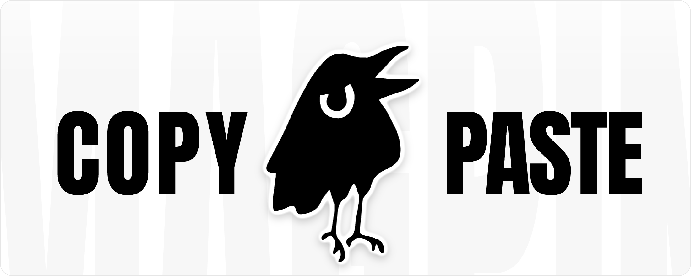
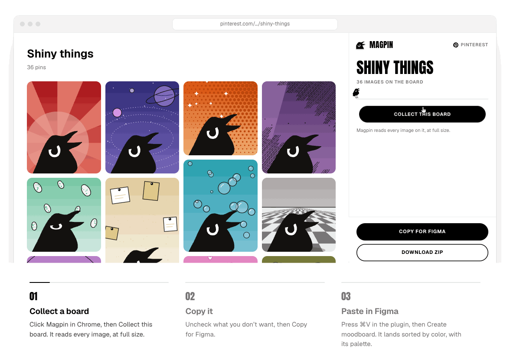
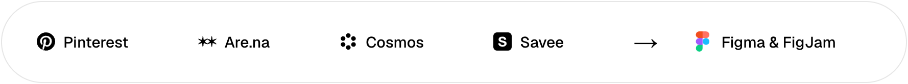
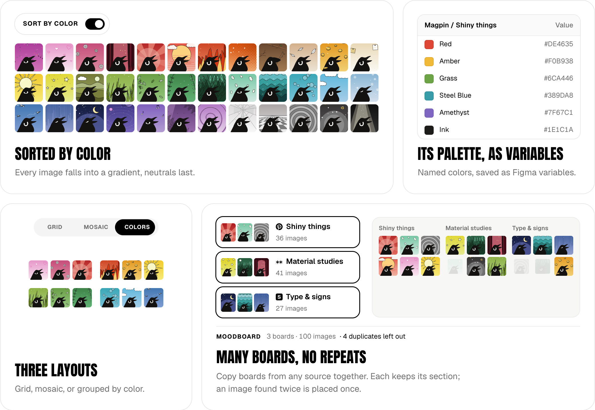

<p align="center">
  <a href="https://magpin.pages.dev"></a>
</p>

<h3 align="center">Your next moodboard is one paste away.</h3>

<p align="center">
  Magpin turns any board from Pinterest, Are.na, Cosmos or Savee into a Figma moodboard,
  sorted by color, with its palette. Free, unlimited, no account.
</p>

<p align="center">
  <a href="https://magpin.pages.dev"><b>Website</b></a>
  &nbsp;·&nbsp;
  <a href="#get-magpin"><b>Chrome extension</b></a>
  &nbsp;·&nbsp;
  <a href="#get-magpin"><b>Figma plugin</b></a>
  &nbsp;·&nbsp;
  <a href="https://magpin.pages.dev/privacy"><b>Privacy</b></a>
</p>

<p align="center">
  
  <a href="LICENSE"></a>
  
  
  
  <a href="https://github.com/getmagpin/magpin/actions/workflows/checks.yml"></a>
</p>

<br>

<p align="center">
  
</p>

## Collect. Copy. Paste.

You spent an evening pinning. Now you need it in Figma, and that usually means saving eighty images one by one, dragging them onto the canvas and lining them up by hand. Magpin does it in three clicks.

1. **Collect a board.** Open a board, click Magpin in Chrome, then **Collect this board**. It reads every image, at full size.
2. **Copy it.** Uncheck what you don't want, then **Copy for Figma**. Got several boards? Add them all to one moodboard first.
3. **Paste in Figma.** Press **⌘V** in the plugin, then **Create moodboard**. It lands sorted by color, numbered, with its palette saved as Figma variables.

No export, no upload, no folder of `IMG_4821.jpg` to clean up.

<p align="center">
  
</p>

## Every pin, in its place.

<p align="center">
  
</p>

- **Sorted by color.** Every image falls into a gradient, with neutrals last. Turn it off to keep the board's own order.
- **Its palette, as variables.** From 3 to 8 named colors (*Brick Red*, *Sage*, *Ink*), saved as Figma color variables, ready to use in the rest of your file.
- **Three layouts.** A clean grid, a mosaic that keeps every image's shape, or blocks grouped by color.
- **Many boards, no repeats.** Mix boards from any source in one moodboard. Each keeps its own section, and an image found twice is placed once, even resized.
- **Unlimited.** Thirty pins or three thousand: no cap per paste, no daily quota.
- **A ZIP when you want files.** The same images as full-size originals, one folder per board.
- **FigJam too.** Same layouts and palette, right on the board.

## Free. All of it.

Similar tools stop at 30 pins on their free plan, or cost $25 to $52. Magpin has no plan: every feature above is the only version there is. No trial, no account, no "Pro". And because it is open source, it stays that way.

## No account. No server. No tracking.

There is nothing to sign up for and nowhere for your boards to go.

- Magpin reads a board **only when you click Collect this board**, on the page you have open.
- The clipboard carries the images' addresses, nothing else.
- Images go straight from the source to your Figma file or your computer.
- The extension asks for the fewest permissions it can: no access to every site, no reading your tabs, no code loaded from elsewhere.

The whole story, in plain words: [privacy policy](https://magpin.pages.dev/privacy).

## Get Magpin

Magpin comes in two parts that work together: the Chrome extension collects, the Figma plugin builds.

<p align="center">
  
  &nbsp;
  
</p>

Can't wait? Build both from source in a couple of minutes, below.

## Build from source

You need Node 20 or later, [pnpm](https://pnpm.io), Chrome 116 or later and the Figma desktop app.

```bash
pnpm install
pnpm build
```

- **Chrome**: open `chrome://extensions`, turn on **Developer mode**, click **Load unpacked** and pick `apps/extension/.output/chrome-mv3`.
- **Figma**: in the desktop app, **Plugins → Development → Import plugin from manifest…** and pick `apps/figma-plugin/manifest.json`.

The [developer guide](docs/DEVELOPMENT.md) covers the rest: live reload, tests, how colors and duplicates are computed, how each source is read, and every permission explained.

## What's inside

A TypeScript monorepo, strict mode, no runtime dependencies on any server.

| Folder | What it is |
| --- | --- |
| [`apps/extension`](apps/extension) | The Chrome extension (Manifest V3, WXT, Preact): side panel, collectors, ZIP. |
| [`apps/figma-plugin`](apps/figma-plugin) | The Figma plugin: preview, color analysis, layouts, palette and variables. |
| [`apps/site`](apps/site) | [magpin.pages.dev](https://magpin.pages.dev), a static one-pager (Lighthouse 100 across the board). |
| [`packages/core`](packages/core) | Shared and tested: color science (OKLab, k-means), duplicates, layouts, exchange format. |
| [`packages/ui`](packages/ui) | The design system: tokens, fonts, and the magpie. |

## Contributing

Boards change their markup now and then. If a source stops collecting, [open an issue](https://github.com/getmagpin/magpin/issues/new) with the board's address: a public board is the easiest to check. Pull requests are welcome; run `pnpm typecheck` and `pnpm test` first.

## License

The code is under the [MIT license](LICENSE). The fonts in `packages/ui/src/fonts` (Anton, Geist) keep their own SIL Open Font License, in the files next to them.

<br>

<p align="center">
  <br>
  <sub>Magpies collect shiny things. So do designers.</sub>
</p>
